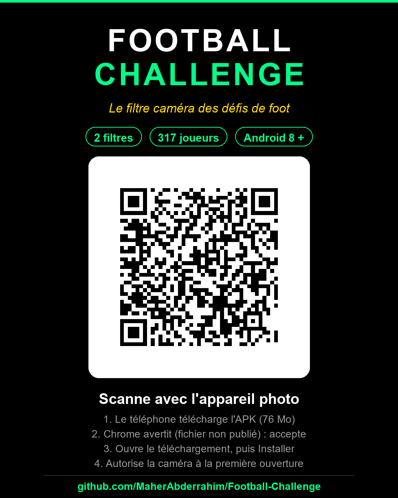

# Football Challenge ⚽

Application mobile (React Native / Expo) pour créer des **vidéos de défis de foot** avec un filtre réel : sélection aléatoire animée de joueurs, cotes de multiplicateurs et enregistrement vidéo du rendu final — pensé pour les réseaux sociaux.

## 📲 Installer sur Android



Scanner ce QR avec l'appareil photo du téléphone, ou télécharger directement
[l'APK](https://github.com/MaherAbderrahim/Football-Challenge/releases/download/v1.0.0/Football-Challenge-v1.0.0.apk) (76 Mo).

1. Le navigateur télécharge le fichier. Chrome avertit que le fichier « peut être nuisible » : c'est un APK signé avec le keystore de debug Expo, absent du Play Store — accepter le téléchargement.
2. Ouvrir la notification de téléchargement, puis **Installer** (Android demande d'autoriser les sources inconnues pour Chrome).
3. Autoriser la **caméra** à la première ouverture.

Compatible **Android 8+** sur téléphone **64 bits (arm64-v8a)**. Deux filtres inclus : *Joueur Arabe* (124 joueurs) et *Transfert Market* (193 cartes joueur + valeur marché).

## ✨ Fonctionnalités

- 🎲 **Tirage aléatoire avec remise** : à chaque appui, un joueur est choisi au hasard parmi **tous** les joueurs disponibles. Les répétitions sont autorisées et normales (la liste n'est jamais modifiée).
- 🎞️ **Animation de roue** : lors d'un tirage, plusieurs joueurs défilent rapidement puis l'animation ralentit et s'arrête sur le joueur tiré.
- 👻 **Bouton d'arrêt invisible** : pendant l'enregistrement, le bouton d'arrêt est totalement transparent (aucune trace dans la vidéo) mais reste parfaitement cliquable.
- 🎥 **Enregistrement vidéo** de l'écran (caméra + filtre) via MediaProjection, avec audio du micro et copie automatique dans la galerie (dossier `FootMimo`).
- 🧍 **Suivi de visage** : la photo du joueur suit votre visage (VisionCamera + détection faciale).
- 🖼️ **Styles de cadre** : Aucun, Simple, Rond, Premium (fond photo transparent).
- 📐 **Réglage du filtre** : déplacer la zone photo, la taille, ajouter du texte, enregistrer des configurations par catégorie.
- 👨‍👩‍👦 **Gestion complète** : catégories, joueurs (import de masse depuis la galerie), cotes, modèles de multiplicateurs.
- 💾 **Base SQLite locale** (Expo SQLite).

## 🛠️ Stack technique

- React Native 0.76 + TypeScript + Expo Router
- react-native-vision-camera + react-native-vision-camera-face-detector
- react-native-worklets-core
- expo-sqlite (catégories, joueurs, configurations, sessions)
- Module natif Android `FilterCameraModule` (enregistrement MediaProjection, sauvegarde galerie)

## 📁 Structure

```
app/                 # Écrans (accueil, challenge-setup, caméra, administration)
src/
  components/        # (selon projets) composants partagés
  constants/         # thème, styles de cadre
  database/          # couche SQLite
  types/             # types TypeScript
  utils/             # géométrie du filtre, stockage images
android/             # Projet Android pré-généré (module natif FilterCameraModule)
tests/               # Tests unitaires (filterGeometry, frameStyles)
photo_arabe/         # Photos des joueurs (exemple de contenu)
```

## 🚀 Installation & build

```bash
npm install
```

### Build Android

```bash
cd android
./gradlew assembleDebug    # APK debug
./gradlew assembleRelease  # APK release (signé avec debug.keystore)
```

APK générés dans `android/app/build/outputs/apk/{debug,release}/`.

> Note : le build release utilise le keystore de debug par défaut (pratique de développement). Pour une distribution réelle, générez votre propre keystore.

## 📱 Utilisation

1. **Accueil** → choisir une catégorie (ex. « Joueur Arabe »).
2. Configurer le **modèle de multiplicateurs** et la **configuration** du filtre (optionnel).
3. **Lancer le défi** → la caméra frontale s'ouvre.
4. **Enregistrer** → appuyez n'importe où sur l'écran pour tirer un joueur : les joueurs défilent puis s'arrêtent sur le joueur sélectionné.
5. Pour **arrêter** : appuyez sur la zone du bouton d'arrêt (invisible) en bas au centre.
6. La vidéo est enregistrée dans la galerie (dossier `Movies/FootMimo`).

## 🧪 Tests

```bash
npm test
```

## 📄 Licence

Projet personnel — à usage de démonstration. Les photos des joueurs utilisées dans `photo_arabe/` appartiennent à leurs ayants droit respectifs.